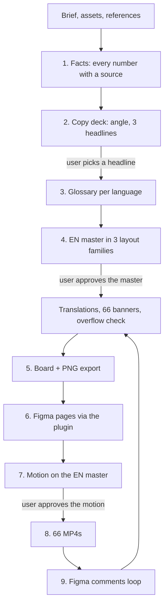
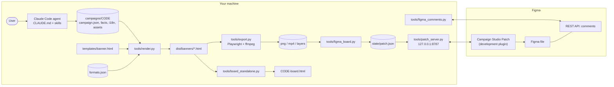

# Campaign Studio

**English** · [Русский](#campaign-studio-ru)

A Claude Code agent that turns a campaign brief into a complete set of ads: copy, a master
visual, every ad format in every language, short animated versions, an HTML review board, and
the same board in Figma. Feedback comes back as Figma comments, and the agent applies it.

- **HTML is the source of truth.** One template renders every format and language, and carries
  the motion.
- **Figma is the review surface.** Pages and frames follow a fixed naming scheme, so a comment on
  a frame maps back to one banner.
- **Video is rendered from the same HTML**, frame by frame, so the last frame of every video is
  exactly the static banner.

## Contents

- [What it produces](#what-it-produces)
- [How the agent works](#how-the-agent-works)
- [Architecture](#architecture)
- [The banner template](#the-banner-template)
- [Figma integration](#figma-integration)
- [Requirements and setup](#requirements-and-setup)
- [Usage](#usage)
- [Repository layout](#repository-layout)
- [Design decisions and limits](#design-decisions-and-limits)

## What it produces

For one campaign with the default `formats.json` (6 formats × 11 languages):

| Output | Where |
|---|---|
| 66 self-contained banner pages (HTML) | `campaigns/<CODE>/dist/banners/` |
| 66 static PNGs (the final frame) | `campaigns/<CODE>/dist/png/` |
| 66 MP4s, H.264, 6 s, 30 fps | `campaigns/<CODE>/dist/mp4/` |
| Per-layer PNGs for motion work (background, chart, sprite, text) | `campaigns/<CODE>/dist/layers/` |
| A review board: rows are languages, columns are formats, live animation | `campaigns/<CODE>/dist/board.html` |
| The same board as one shareable HTML file (~180 KB) | `campaigns/<CODE>/dist/<CODE>-board.html` |
| Three Figma pages: Master visuals, Formats, video layers | the Figma file named in `state/figma.json` |

Default formats: 1080×1080, 1080×1350, 1080×1920 (Meta feed and Stories) and 1200×1200,
960×1200, 1200×628 (Google Performance Max). Frames are named
`{CODE}_{W}x{H}_{Static|Video}_{LANG}_v{N}`.

## How the agent works

The agent is Claude Code plus the instructions in this repository: `CLAUDE.md` (role, commands,
rules) and the skills in `.claude/skills/`. The main skill, `campaign-build`, runs the campaign
in a fixed order and stops for the user's approval at four points.



1. **Facts.** The agent reads the spec, tickets and chat history it is pointed at and writes
   `facts.md`: each number with its source and status. Copy may only use numbers from this file;
   anything missing is written as `[VERIFY: …]`.
2. **Copy.** Angle first, then three headline options, then copy for every slot in a long and a
   short version.
3. **Glossary.** For each language, the category's own vocabulary with source URLs, plus how that
   market writes prices, percents and currency.
4. **Master and formats.** The EN row is built first and approved before any translation.
   `render.py` builds every format × language and fails loudly on overflow.
5. **Board.** HTML board and PNG export.
6. **Figma.** A patch for the plugin; one click in Figma Desktop applies it.
7. **Motion.** One seekable timeline in the template.
8. **Video.** Frame-exact MP4 export, run in the background.
9. **Comments.** Read through the REST API, mapped to a banner, applied, rebuilt, patched, and
   answered in the thread.

## Architecture



| Component | File | Role |
|---|---|---|
| Agent instructions | `CLAUDE.md`, `CLAUDE.local.md` (local) | Role, commands, rules; local file adds client and machine specifics |
| Campaign workflow | `.claude/skills/campaign-build/` | The nine steps and the approval stops |
| Localization | `.claude/skills/localize/` | Glossary, per-language files, checks |
| Comment workflow | `.claude/skills/figma-comments-loop/` | Read, map, edit, rebuild, patch, reply |
| Formats | `formats.json` | Sizes, platforms, layout family, content slots, languages, naming, video spec |
| Template | `templates/banner.html` | Three layout families, auto-fit, RTL, one seekable timeline |
| Renderer | `tools/render.py` | Injects config + copy into the template per format × language; overflow check |
| Exporter | `tools/export.py` | PNG of the final frame, MP4 frame by frame, isolated layers, contact sheets |
| Share board | `tools/board_standalone.py` | One HTML file with every banner, assets inlined |
| Figma patch | `tools/figma_board.py` | Builds the plugin patch for the three pages; records node ids |
| Bridge | `tools/patch_server.py` | Serves the patch to the plugin, inlines files, stores the report |
| Comments | `tools/figma_comments.py` | `check`, `fetch`, `reply` over the Figma REST API |
| Plugin | `plugin/` | Applies patch ops through the Figma Plugin API; strict stub tests |

## The banner template

`templates/banner.html` is a single page that becomes any banner once `render.py` injects a
`window.CFG` object (size, layout family, slots, language, direction, copy, assets, theme).

- **Three layout families.** `block` (1:1 and 4:5), `vertical` (9:16, content kept inside the
  platform safe areas), `wide` (1.91:1, short copy only).
- **Fit before cut.** If a headline is wider than its column, the type scales down to 70% of its
  size first. Only then do slots switch to their `.short` copy, in the order set in
  `campaign.json`. Anything still overflowing is reported and fails `--check`.
- **Measured placement.** The chart element takes the largest free slot next to or under the text,
  measured from the painted text lines, not from block boxes.
- **RTL.** Languages listed in `rtl` get `dir="rtl"`; layout uses logical properties. CJK and
  Arabic switch to Noto fallbacks.
- **One timeline.** All motion is a pure function `seek(t)` of time: entrances with a strong
  ease-out, numbers counting up from zero, the chart rising, a sprite flying along a curve, a
  shine on the CTA. The browser plays it with `requestAnimationFrame`; the exporter calls
  `seek()` frame by frame, so videos are frame-exact and independent of machine speed.
  `seek(T)` is the static banner. `prefers-reduced-motion` shows the final frame.
- **Layers.** `?layer=bg|candles|rocket|text` isolates one layer on a transparent page for the
  video-layers export.
- **Theme.** Every colour is a CSS token; a campaign overrides them in `campaign.json`.

## Figma integration

Three channels, each used for what only it can do:

| Channel | Used for | Why |
|---|---|---|
| Development plugin + local bridge | Every write: pages, frames, labels, images | No monthly call cap; deterministic; reports per op |
| REST API with a personal token | Reading and answering comments | Neither the Plugin API nor the MCP server can read comments |
| Figma MCP server | Optional, only for what the plugin cannot do | Capped at a small number of calls per month on free and view seats |

Safety built into the plugin:

- Every patch names its target file; opened in another file it changes nothing.
- Re-runs are idempotent: the campaign's own pages are emptied first, other pages are untouched.
- On plans with a page limit, an empty spare page is reused instead of failing.
- Pages are loaded before their children are read (`dynamic-page` access).

Each campaign gets three pages:

1. `{CODE} — Master visuals`: the EN row and the source assets.
2. `{CODE} — Formats`: one row per language, a `label - <frame>` text above every frame.
3. `{CODE} — video layers`: per format, background, chart, sprite and text as separate frames,
   for anyone who wants to re-animate in a motion tool.

## Requirements and setup

- [Claude Code](https://claude.com/claude-code)
- Python 3.10+
- ffmpeg on PATH
- Figma Desktop (development plugins do not run in the browser)

```bash
python -m venv .venv
.venv/Scripts/python -m pip install playwright pillow
.venv/Scripts/python -m playwright install chromium
```

On macOS and Linux use `.venv/bin/python`.

1. **Figma token.** Create a personal access token with the scope *File comments: read and
   write*. Save it as `secrets/figma-token.txt` (one line), or as `~/.figma-token`.
2. **Figma file.** Create `state/figma.json`:
   ```json
   { "file": "Campaigns", "fileKey": "<key from the file URL>", "campaigns": {} }
   ```
   `file` must match the Figma file's name exactly.
3. **Plugin.** In Figma Desktop: Plugins → Development → Import plugin from manifest →
   `plugin/manifest.json`.
4. **Skills.** This repository ships three skills. The workflow also expects a copywriting skill
   (`copy`), design skills (`design-taste-frontend`, `high-end-visual-design`, `brandkit-images`),
   motion skills (`animate`, `review-animations`, `animation-vocabulary`) and `figma-build`,
   installed in `.claude/skills/` or `~/.claude/skills/`. Use your own or community equivalents;
   the agent says which one is missing and falls back to the closest.
5. **Local instructions (optional).** `CLAUDE.local.md` is for client brand rules, the comment
   author's handle and machine paths. It is imported by `CLAUDE.md` and never committed.

## Usage

Start Claude Code in the repository and talk to it:

| Say | What happens |
|---|---|
| a brief, or a link to a spec | `campaign-build` starts at step 1 |
| "rebuild the board" | render, check, export PNGs |
| "push to Figma" | patch written, bridge started; you click the plugin once |
| "make the videos" | MP4 export in the background |
| "check comments" | comments read, applied, answered |

The tools can also be run directly:

```bash
.venv/Scripts/python tools/render.py SPRING25 --check            # build every banner, fail on overflow
.venv/Scripts/python tools/export.py SPRING25 --sheet            # PNG per banner + contact sheets
.venv/Scripts/python tools/export.py SPRING25 --video            # MP4 per banner
.venv/Scripts/python tools/export.py SPRING25 --match _EN_ --layers
.venv/Scripts/python tools/board_standalone.py SPRING25          # one shareable HTML file
.venv/Scripts/python tools/figma_board.py SPRING25               # plugin patch
.venv/Scripts/python tools/patch_server.py                       # bridge for the plugin
.venv/Scripts/python tools/figma_board.py SPRING25 --record      # node ids after the run
.venv/Scripts/python tools/figma_comments.py fetch               # open comment threads
.venv/Scripts/python plugin/test/run_stub_tests.py               # plugin against the strict stub
```

## Repository layout

```
CLAUDE.md                   agent role, commands, rules
formats.json                formats, languages, naming, video spec
templates/banner.html       the banner template
tools/                      render, export, board, Figma patch, bridge, comments, duotone
plugin/                     Figma development plugin + strict API stub tests
.claude/skills/             campaign-build, localize, figma-comments-loop
campaigns/README.md         campaign folder format (campaign folders themselves stay local)
brand/README.md             brand folder format (local)
glossary/README.md          glossary format (local)
```

Not committed: `campaigns/*`, `brand/*`, `glossary/*`, `state/`, `secrets/`, `CLAUDE.local.md`,
third-party skills.

## Design decisions and limits

- **HTML first, Figma second.** Layout, copy and motion live in one template; Figma receives
  rendered frames (images) plus labels. Editing a banner means editing the template or the copy,
  not the Figma layers.
- **Data, not drawings.** 66 banners come from one template, one formats file and one copy file
  per language. The model writes copy once and translates strings, not pages.
- **Checks are mechanical.** Overflow, edge collisions and text-over-chart overlap are measured
  in the browser for every banner on every build.
- **Translations are machine translations** until a native speaker reviews them.
- **Videos are not uploaded to Figma.** Keep final PNG and MP4 files in shared storage; `dist/`
  is rebuilt from source and is not committed.
- **Platform rules change.** Safe areas and text-on-image policies of ad platforms should be
  checked against their current documentation.

---

<a id="campaign-studio-ru"></a>

# Campaign Studio (RU)

[English](#campaign-studio) · **Русский**

Агент для Claude Code, который по брифу собирает полный комплект рекламы: тексты, мастер-визуал,
все форматы на всех языках, короткие анимированные версии, HTML-полотно для ревью и то же
полотно в Figma. Правки приходят комментариями в Figma, и агент их применяет.

- **Источник истины — HTML.** Один шаблон рендерит все форматы и языки и содержит анимацию.
- **Figma — место для ревью.** Страницы и фреймы названы по фиксированной схеме, поэтому
  комментарий на фрейме однозначно указывает на один баннер.
- **Видео рендерится из того же HTML** кадр за кадром, поэтому последний кадр каждого видео
  в точности совпадает со статичным баннером.

## Что получается на выходе

Для одной кампании с `formats.json` по умолчанию (6 форматов × 11 языков):

| Результат | Где |
|---|---|
| 66 самостоятельных HTML-баннеров | `campaigns/<CODE>/dist/banners/` |
| 66 PNG (последний кадр) | `campaigns/<CODE>/dist/png/` |
| 66 MP4, H.264, 6 с, 30 fps | `campaigns/<CODE>/dist/mp4/` |
| PNG по слоям для моушна (фон, график, спрайт, текст) | `campaigns/<CODE>/dist/layers/` |
| Полотно для ревью: ряды — языки, колонки — форматы, живая анимация | `campaigns/<CODE>/dist/board.html` |
| То же полотно одним HTML-файлом (~180 КБ) | `campaigns/<CODE>/dist/<CODE>-board.html` |
| Три страницы в Figma: Master visuals, Formats, video layers | файл из `state/figma.json` |

Форматы по умолчанию: 1080×1080, 1080×1350, 1080×1920 (лента и Stories Meta) и 1200×1200,
960×1200, 1200×628 (Google Performance Max). Имена фреймов:
`{CODE}_{W}x{H}_{Static|Video}_{LANG}_v{N}`.

## Как работает агент

Агент — это Claude Code плюс инструкции из репозитория: `CLAUDE.md` (роль, команды, правила) и
скиллы в `.claude/skills/`. Главный скилл `campaign-build` ведёт кампанию в фиксированном порядке
и в четырёх местах останавливается и ждёт подтверждения пользователя.

1. **Факты.** Агент читает спецификацию, задачи и переписку, на которые ему указали, и пишет
   `facts.md`: каждая цифра с источником и статусом. В текстах можно использовать только цифры
   из этого файла; чего нет, помечается `[VERIFY: …]`.
2. **Тексты.** Сначала угол подачи, потом три варианта заголовка (**стоп: выбор заголовка**),
   потом тексты для каждого слота в длинной и короткой версии.
3. **Глоссарий.** Для каждого языка — лексика категории со ссылками на источники и правила рынка
   для цен, процентов и валюты.
4. **Мастер и форматы.** Сначала собирается EN-ряд (**стоп: утверждение мастера**), потом
   переводы. `render.py` собирает все форматы × языки и падает при переполнении.
5. **Полотно.** HTML-полотно и экспорт PNG.
6. **Figma.** Патч для плагина; один клик в Figma Desktop его применяет.
7. **Анимация.** Одна таймлайн-функция в шаблоне (**стоп: утверждение анимации**).
8. **Видео.** Покадровый экспорт MP4 в фоне.
9. **Комментарии.** Чтение через REST API, привязка к баннеру, правка, пересборка, патч и ответ
   в ветке комментария.

## Архитектура

Схема — в английской части выше. Компоненты:

| Компонент | Файл | Роль |
|---|---|---|
| Инструкции агента | `CLAUDE.md`, `CLAUDE.local.md` (локально) | Роль, команды, правила; локальный файл добавляет специфику клиента и машины |
| Процесс кампании | `.claude/skills/campaign-build/` | Девять шагов и точки подтверждения |
| Локализация | `.claude/skills/localize/` | Глоссарий, файлы по языкам, проверки |
| Комментарии | `.claude/skills/figma-comments-loop/` | Чтение, привязка, правка, пересборка, патч, ответ |
| Форматы | `formats.json` | Размеры, площадки, семейство раскладки, слоты, языки, схема имён, параметры видео |
| Шаблон | `templates/banner.html` | Три семейства раскладки, автоподбор, RTL, один таймлайн |
| Рендер | `tools/render.py` | Подставляет конфиг и тексты в шаблон для каждого формата × языка; проверка переполнения |
| Экспорт | `tools/export.py` | PNG последнего кадра, MP4 покадрово, отдельные слои, контактные листы |
| Полотно для шаринга | `tools/board_standalone.py` | Один HTML-файл со всеми баннерами, ассеты встроены |
| Патч для Figma | `tools/figma_board.py` | Собирает патч для трёх страниц; записывает id узлов |
| Мост | `tools/patch_server.py` | Отдаёт патч плагину, встраивает файлы, сохраняет отчёт |
| Комментарии | `tools/figma_comments.py` | `check`, `fetch`, `reply` через Figma REST API |
| Плагин | `plugin/` | Применяет операции патча через Figma Plugin API; строгие тесты на заглушке |

## Шаблон баннера

`templates/banner.html` — одна страница, которая становится любым баннером, когда `render.py`
подставляет объект `window.CFG` (размер, раскладка, слоты, язык, направление текста, тексты,
ассеты, тема).

- **Три семейства раскладки:** `block` (1:1 и 4:5), `vertical` (9:16, контент внутри безопасных
  зон площадки), `wide` (1.91:1, только короткие тексты).
- **Сначала уменьшить, потом сокращать.** Если заголовок шире колонки, шрифт уменьшается до 70%.
  Только после этого слоты переключаются на `.short`-тексты в порядке из `campaign.json`. Если
  что-то всё ещё не влезает, `--check` падает с отчётом.
- **Расстановка по замерам.** График занимает самое большое свободное место рядом с текстом или
  под ним; замер идёт по реальным строкам текста, а не по блокам.
- **RTL.** Языки из списка `rtl` получают `dir="rtl"`, раскладка на логических свойствах. Для
  CJK и арабского подключаются шрифты Noto.
- **Один таймлайн.** Вся анимация — чистая функция времени `seek(t)`: появления с сильным
  ease-out, отсчёт цифр от нуля, рост графика, полёт спрайта по кривой, блик на кнопке. Браузер
  проигрывает её через `requestAnimationFrame`, экспорт вызывает `seek()` для каждого кадра,
  поэтому видео покадрово точное и не зависит от скорости машины. `seek(T)` — статичный баннер.
  При `prefers-reduced-motion` показывается последний кадр.
- **Слои.** `?layer=bg|candles|rocket|text` оставляет один слой на прозрачном фоне для экспорта
  слоёв видео.
- **Тема.** Все цвета — CSS-токены; кампания переопределяет их в `campaign.json`.

## Интеграция с Figma

| Канал | Для чего | Почему |
|---|---|---|
| Плагин + локальный мост | Вся запись: страницы, фреймы, подписи, картинки | Нет месячного лимита вызовов; детерминированно; отчёт по каждой операции |
| REST API с персональным токеном | Чтение комментариев и ответы | Ни Plugin API, ни MCP не умеют читать комментарии |
| Figma MCP | По желанию, только то, что не умеет плагин | На бесплатных тарифах и view-местах ограничен небольшим числом вызовов в месяц |

Защиты в плагине:

- Каждый патч привязан к файлу по названию; в другом файле он ничего не меняет.
- Повторный запуск не создаёт дублей: страницы кампании сначала очищаются, остальные не трогаются.
- На тарифах с лимитом страниц занимается пустая свободная страница вместо ошибки.
- Перед чтением содержимого страница загружается (режим доступа `dynamic-page`).

Страницы кампании: `{CODE} — Master visuals` (EN-ряд и исходники), `{CODE} — Formats` (ряд на
язык, подпись `label - <frame>` над каждым фреймом), `{CODE} — video layers` (по каждому формату
фон, график, спрайт и текст отдельными фреймами — для тех, кто хочет переанимировать в моушн-
редакторе).

## Требования и установка

- [Claude Code](https://claude.com/claude-code), Python 3.10+, ffmpeg в PATH, Figma Desktop
  (плагины в разработке не работают в браузере).
- Окружение: команды из английской части (`python -m venv .venv`, `pip install playwright pillow`,
  `playwright install chromium`).

1. **Токен Figma.** Персональный токен со scope *File comments: read and write*, одной строкой в
   `secrets/figma-token.txt` или `~/.figma-token`.
2. **Файл Figma.** `state/figma.json` с полями `file` (точное название файла), `fileKey` (из URL)
   и `campaigns: {}`.
3. **Плагин.** Figma Desktop → Plugins → Development → Import plugin from manifest →
   `plugin/manifest.json`.
4. **Скиллы.** В репозитории три своих скилла. Процесс также рассчитывает на скилл копирайтинга
   (`copy`), дизайна (`design-taste-frontend`, `high-end-visual-design`, `brandkit-images`),
   анимации (`animate`, `review-animations`, `animation-vocabulary`) и `figma-build` — свои или
   из сообщества, в `.claude/skills/` или `~/.claude/skills/`. Если какого-то нет, агент скажет
   и возьмёт ближайший.
5. **Локальные инструкции (по желанию).** `CLAUDE.local.md` — бренд-правила клиента, ник автора
   комментариев, пути на машине. Подключается из `CLAUDE.md` и не коммитится.

## Использование

Запустите Claude Code в репозитории и пишите ему:

| Скажите | Что произойдёт |
|---|---|
| бриф или ссылку на спецификацию | `campaign-build` с шага 1 |
| «пересобери полотно» | рендер, проверка, экспорт PNG |
| «залей в Figma» | патч и мост; вы один раз жмёте плагин |
| «сделай видео» | экспорт MP4 в фоне |
| «проверь комментарии» | комментарии прочитаны, применены, в ветках ответы |

Инструменты можно запускать и напрямую — команды в английской части.

## Структура репозитория

```
CLAUDE.md                   роль агента, команды, правила
formats.json                форматы, языки, схема имён, параметры видео
templates/banner.html       шаблон баннера
tools/                      рендер, экспорт, полотно, патч Figma, мост, комментарии, duotone
plugin/                     плагин Figma + строгие тесты на заглушке API
.claude/skills/             campaign-build, localize, figma-comments-loop
campaigns/README.md         формат папки кампании (сами кампании остаются локально)
brand/README.md             формат папки бренда (локально)
glossary/README.md          формат глоссария (локально)
```

Не коммитятся: `campaigns/*`, `brand/*`, `glossary/*`, `state/`, `secrets/`, `CLAUDE.local.md`,
сторонние скиллы.

## Решения и ограничения

- **Сначала HTML, потом Figma.** Раскладка, тексты и анимация живут в одном шаблоне; в Figma
  попадают отрендеренные фреймы (картинки) и подписи. Правка баннера — это правка шаблона или
  текста, а не слоёв в Figma.
- **Данные, а не отрисовка.** 66 баннеров получаются из одного шаблона, одного файла форматов и
  одного файла текстов на язык. Модель пишет тексты один раз и переводит строки, а не страницы.
- **Проверки механические.** Переполнение, выход за край и наезд текста на график замеряются в
  браузере для каждого баннера при каждой сборке.
- **Переводы машинные**, пока их не проверит носитель языка.
- **Видео не загружаются в Figma.** Финальные PNG и MP4 стоит хранить в общем хранилище; `dist/`
  пересобирается из исходников и не коммитится.
- **Правила площадок меняются.** Безопасные зоны и политики текста на изображениях стоит
  сверять с актуальной документацией площадок.
